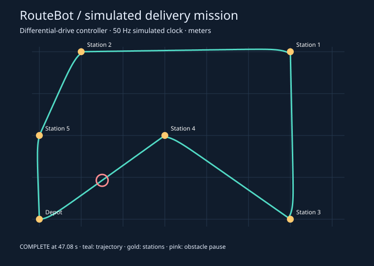
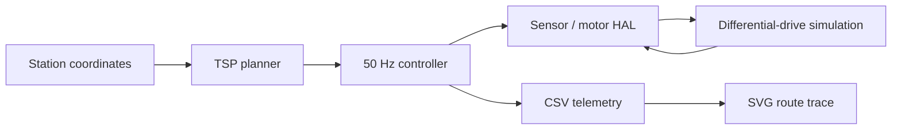

# RouteBot

**A C delivery-robot controller and software-in-the-loop simulator for warehouse route planning and mission execution.**

RouteBot plans a delivery tour through six warehouse stations, then executes it with a differential-drive controller. A simulated sensor/motor interface makes stop behavior, sensor failures, and command timeouts testable without a robot.



## Run it

Requirements: a C17 compiler, Make, and Python 3. No third-party Python packages.

```sh
make
make test
make demo
```

Open `build/demo.svg` to see the driven path. `build/telemetry.csv` contains every control step. The simulation runs as fast as the host allows; each step represents 20 ms, rather than sleeping in real time.

```sh
./build/routebot normal > build/normal.csv
./build/routebot obstacle > build/obstacle.csv
./build/routebot estop > build/estop.csv
./build/routebot dropout > build/dropout.csv
make sanitize
```

Normal and obstacle missions exit 0. Emergency-stop and sensor-dropout scenarios intentionally exit 1 when a fault is latched. Invalid arguments exit 2. Summary information goes to stderr and CSV telemetry to stdout.

## What this demonstrates

- Three TSP heuristics: input order, nearest neighbor, and nearest insertion, with deterministic tie handling.
- A bounded, allocation-free application core: at most 32 stations, with fixed-size route and distance storage.
- A periodic controller with explicit RUNNING, BLOCKED, COMPLETE, and FAULT states.
- Differential-drive wheel commands from heading error and distance to the next waypoint.
- A hardware abstraction layer (HAL) separating controller decisions from sensor reads and motor writes.
- Fault injection, a simulated independent motor-command watchdog, and C/Python regression tests.
- A CI workflow that runs the tests and AddressSanitizer/UndefinedBehaviorSanitizer on Ubuntu.

## Measured demo

For the included six-station layout:

| Method | Planned closed-tour distance |
| --- | ---: |
| Given | 27.22 m |
| Nearest | 20.67 m |
| Insert | 20.45 m |

Insertion produces a route about **24.9% shorter than the supplied order for this layout**. This is a heuristic result, not a general optimality guarantee. The obstacle scenario completes in 47.08 simulated seconds, including its three-second pause. The reported driven distance is 20.27 m: waypoints are accepted within 6 cm, so the simulated path need not pass through their exact centers.

## Architecture



| File | Responsibility |
| --- | --- |
| `src/planner.c` | Cartesian tour construction; O(n²) nearest/insert, O(n) given, O(n) storage |
| `src/controller.c` | State transitions, waypoint tracking, validation and fault latching |
| `include/routebot.h` | Public contracts, units, limits and HAL callbacks |
| `src/sim.c` | Idealized motion, sensors and motor watchdog |
| `src/main.c` | Demo mission, scenario injection, virtual clock and telemetry |
| `tests/` | Algorithm checks, boundary cases, failure behavior and full mission checks |
| `tools/plot.py` | Dependency-free SVG generation |

See [design and limitations](docs/design.md), [test evidence](docs/testing.md), and [development guide](docs/learning.md).

## Scope

RouteBot uses traveling salesperson heuristics to plan closed delivery tours through Cartesian warehouse coordinates in meters. Its planner, controller, simulator, and tests are contained in this directory, with no dependency on the parent workspace.

This is a **host-based software-in-the-loop project**. It has not run on a microcontroller or physical robot. It does not demonstrate hardware bring-up, real-time deadline verification, certified functional safety, ROS, CAN, or an RTOS. The simulator assumes exact pose, ideal wheel response, and a flat obstacle-free plane except for an injected binary obstacle signal. It stops for obstacles; it does not plan around them.

## Publishing

This directory is self-contained. Copy its contents into a new GitHub repository as the repository root so `.github/workflows/ci.yml` is discovered. Keep `build/` untracked. The checked-in demo image can be regenerated with `make demo` and copied from `build/demo.svg` to `docs/demo.svg`.

Build artifacts are excluded by `.gitignore`.
